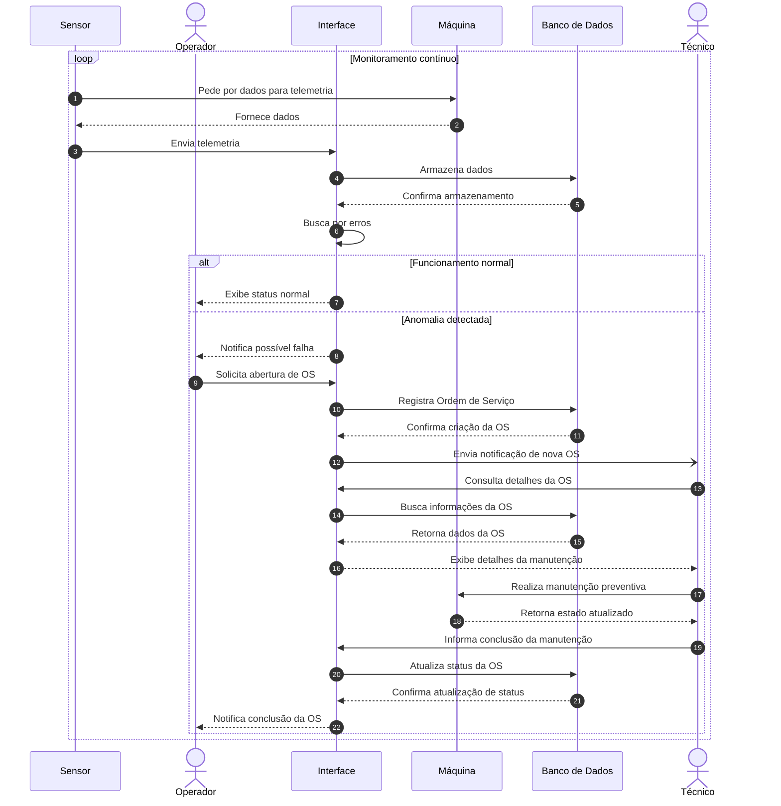
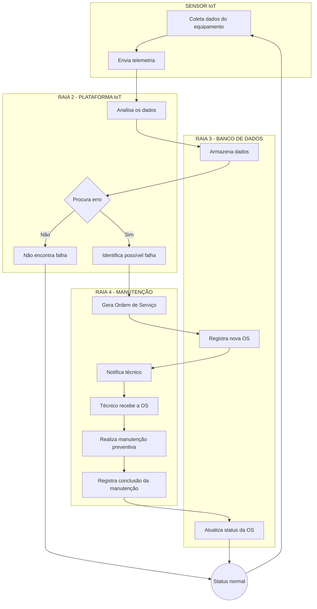
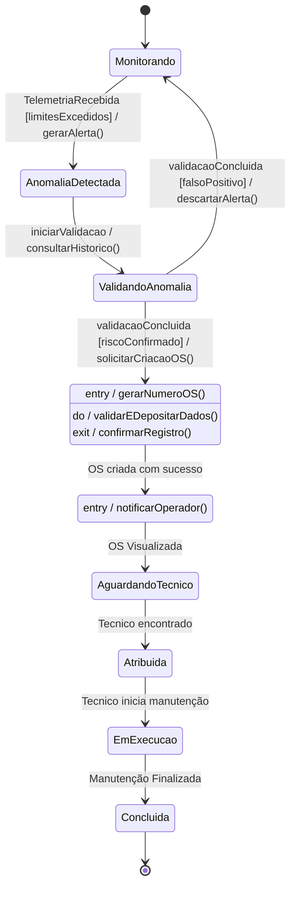
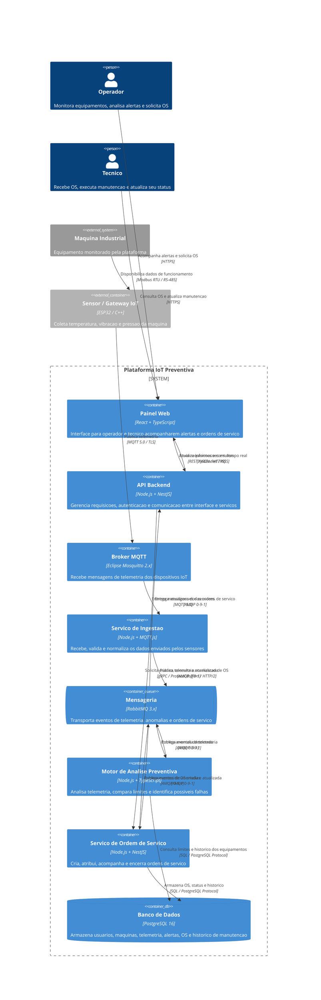

Como tema do meu grupo foi "IoT preventiva" e o tema individual da APS2 dentro do tema principal foi "geração de OS".

No arquivo do C4 nível 2 eu não consegui encontrar uma forma de fazer as relações pararem de se sobrepor de forma a ficarem inelegíveis, infelizmente só tem como entender certos textos lendo o código devido
a essa sobreposição que ocorreram em alguns pontos do diagrama.

Diagrama de sequencia:

Diagrama de atividade:

Diagrama de estados:

Diagrama C4 nível 2 (Visão de container):

